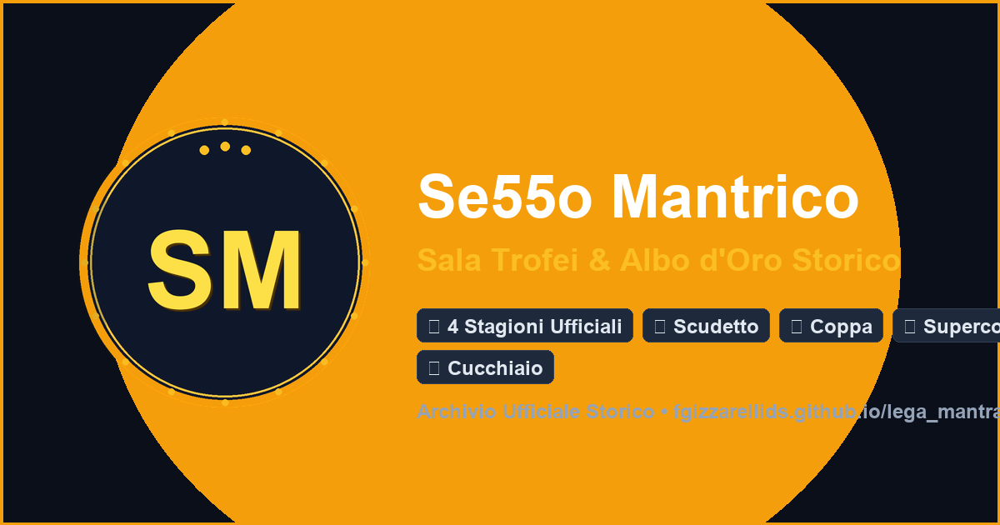

# Se55o Mantrico • Sala Trofei & Analytics Hub

[](https://github.com/fgizzarelliDS/lega_mantra_sm_sala_trofei/actions/workflows/deploy.yml)
[](https://github.com/fgizzarelliDS/lega_mantra_sm_sala_trofei/actions/workflows/ci.yml)
[](package.json)
[](https://www.typescriptlang.org/)
[](LICENSE)

> Albo d'oro interattivo, motore league-agnostic, analisi econometrica di competitività, dinamica storica, record all-time, H2H e schede manager per la lega Fantacalcio **Se55o Mantrico**.

---

## Panoramica

**Se55o Mantrico Sala Trofei** evolve il classico albo d'oro statico in un hub storico e analitico completo per la lega Fantacalcio Mantra **Se55o Mantrico** (fondata nella stagione 2022/23).

L'applicazione offre un'interfaccia interattiva desktop e mobile ad alte prestazioni:

- **Architettura League-Agnostic**: Configurazione centralizzata (`src/config.ts`), colonne del tabellone reattive (layout a 5 colonne: Manager, Scudetto, Coppa di Lega, Supercoppa, Cucchiaio di Legno), isolamento multi-tenant in local storage.
- **Albo d'Oro & Palmarès Storico**: 4 stagioni complete archiviate (2022/23 a 8 squadre, 2023/24 – 2025/26 a 10 squadre), 12 manager storici, rating calcolato e schede manager ad alta risoluzione (HD) condivisibili via WhatsApp.
- **Bacheca Record Storici (Hall of Fame & Primati)**: 25 record all-time calcolati dinamicamente sulle 4 stagioni (Punti & Podi, Dominio & Coppe, Rivalità H2H, Strisce & Fedeltà, Disonori & Curiosità) con navigazione contestuale ed export Poster HD.
- **Head-to-Head (H2H) & Nemesis Matrix**: Motore di confronto diretto 1vs1 tra tutti i manager, grafici radar pentagonali a 5 assi, barre duello con preservazione dello scroll, tabellino storico annate ed esportazione ad alta definizione.
- **Archivio Stagioni & Classifiche**: Consultazione cronologica delle singole annate con classifiche complete, punteggi, podi e finaliste delle coppe.
- **Dinamica Storica & Cronologia (Tab 4)**: Analisi longitudinale delle carriere (piazzamento medio storico, fasce di rendimento a 4 livelli, baricentro e oscillazione) ed evoluzione dell'equilibrio competitivo stagionale.
- **Econometria & Teoria del Rischio**: Indici di disuguaglianza (Gini bivariato, HHI, Concentrazione Top-3, Entropia Relativa), cinismo dei podi (Killer Instinct, Finals Conversion Rate) e modellazione di coda (Bayesian Feast-or-Famine, Net Tail Index).
- **Branding & Crest Dedicati**: Emblema araldico monogramma "SM" oro antico e catalogo stemmi vettoriali per ogni franchigia.
- **Live Application**: [fgizzarellids.github.io/lega_mantra_sm_sala_trofei](https://fgizzarellids.github.io/lega_mantra_sm_sala_trofei/)
- **Database Ufficiale**: `public/data.json` (compilato dai file sorgente in `data/`)



---

## Manutenzione & Sincronizzazione con l'Upstream

Questo repository è una derivazione league-agnostic del motore **[InsalAtlas Sala Trofei](https://github.com/fgizzarelliDS/insalatlas_sala_trofei)** (upstream). 
Tutte le migliorie al motore analitico, alle componenti UI, all'accessibilità e alle ottimizzazioni prestazionali possono essere importate in sicurezza senza sovrascrivere i dati e le configurazioni specifiche di Se55o Mantrico.

### Architettura di Protezione (`merge=ours`)

Il file [`.gitattributes`](.gitattributes) protegge i file proprietari di Se55o Mantrico assegnando loro il driver `merge=ours`:
- `data/**` (database modulare stagioni, manager, titoli, alias)
- `public/data.json` (database consolidato compilato)
- `src/config.ts` (titolo lega, brand, colonne, pesi trofei)
- `src/__tests__/league.integrity.test.ts` (test di integrità del database di Se55o Mantrico)
- `index.html` (metatag OpenGraph, favicon e titolo finestra)
- `README.md` (documentazione specifica della lega)

> [!IMPORTANT]
> **Configurazione One-Time del Driver Git:**
> Affinché Git rispetti l'attributo `merge=ours` durante i comandi di merge, è necessario registrare il driver una volta nel proprio ambiente locale:
> ```bash
> git config merge.ours.driver true
> ```

### Procedura di Aggiornamento dall'Upstream

Per sincronizzare il codice con le nuove feature dell'upstream:

```bash
# 1. Configura il remote upstream se non presente
git remote add upstream https://github.com/fgizzarelliDS/insalatlas_sala_trofei.git

# 2. Scarica le ultime modifiche dall'upstream
git fetch upstream

# 3. Unisci i miglioramenti del motore (i file in .gitattributes rimarranno intatti)
git merge upstream/main

# 4. Verifica validità schema e test suite
npm run validate:data
npm test
npm run type-check
npm run build

# 5. Pubblica su GitHub Pages
git push origin main
```

---

## Documentazione Tecnica Modulare

La documentazione approfondita del motore è consultabile in [`docs/`](docs/):

1. **[Architettura & Invarianti Tecniche](docs/01-architecture-invariants.md)**: Configurazione colonne reattive, palette colori, design token e pipeline Vite.
2. **[Funzionalità & Esperienza Utente](docs/02-features-and-ui.md)**: Tabellone palmarès, schede manager HD, H2H, share WhatsApp e navigazione archivio.
3. **[Econometria, Cinismo & Modelli di Rischio](docs/03-analytics-and-econometrics.md)**: Modelli matematici formali: SPI, Gini, HHI, Killer Instinct, Feast-or-Famine Bayesiano e tassonomia degli archetipi.
4. **[Data Schema & Validazione CI/CD](docs/04-data-schema-and-ci.md)**: Schema contrattuale `data.json`, script di build (`build_data.py`) e validatore di integrità (`validate.py`).

---

## Quick Start (Sviluppo Locale)

```bash
# 1. Clona il repository
git clone https://github.com/fgizzarelliDS/lega_mantra_sm_sala_trofei.git
cd lega_mantra_sm_sala_trofei

# 2. Installa le dipendenze
npm install

# 3. Abilita il driver git merge per proteggere i dati locali
git config merge.ours.driver true

# 4. Compila e valida il database
npm run build:data     # genera public/data.json da data/
npm run validate:data  # certifica schema e coerenza relazionale

# 5. Esegui la suite di test (14 suite, 289 test)
npm test

# 6. Avvia il server di sviluppo locale
npm run dev

# 7. Type-checking e build di produzione
npm run type-check
npm run build
```
